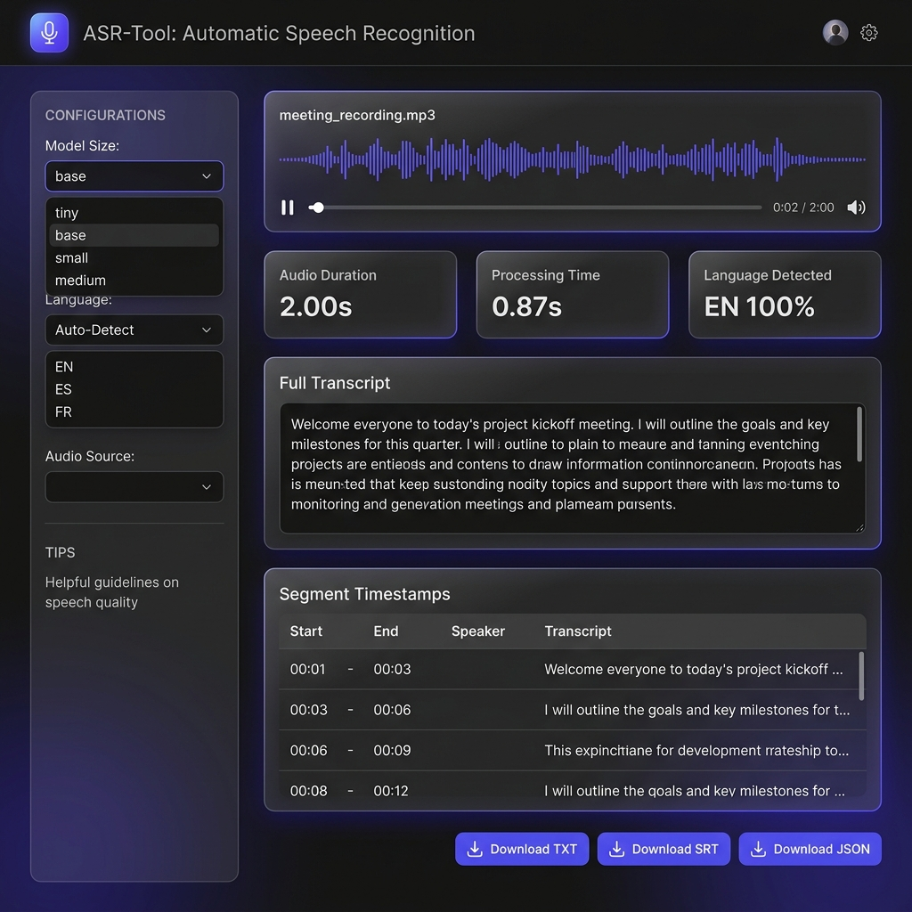

# ASR-Tool: Offline Automatic Speech Recognition

[](LICENSE)
[](https://www.python.org/)
[](https://github.com/SYSTRAN/faster-whisper)
[](https://streamlit.io/)

**ASR-Tool** is a high-performance, university-project Automatic Speech Recognition application that transcribes speech audio into accurate text completely offline—with **zero external or paid API key dependencies**. Built with Python, `faster-whisper` (C++ CTranslate2 engine), and `Streamlit`, ASR-Tool delivers fast transcription with word-level timestamps, language detection, and multi-format exports (.txt, .srt, .json).

---

## 📸 Web UI Preview



---

## ✨ Features List

- 🎧 **Multi-Format Audio Transcribing**: Supports `.wav`, `.mp3`, `.m4a`, `.flac`, and `.ogg`.
- 🎤 **Live Microphone Recording**: Built-in browser audio recorder for instant transcription.
- ⚡ **Offline Whisper Models**: Switch between `tiny`, `base`, `small`, and `medium` models locally.
- 🌐 **Auto Language Detection**: Detects over 99 languages with confidence scoring.
- ⏱️ **Timestamp Segmentation**: Precise segment-level start/end timestamps.
- 💾 **Multi-Format Exporters**: Save outputs as Plain Text (`.txt`), Subtitle (`.srt`), or Structured (`.json`).
- 📊 **Performance Analytics**: Displays real-time audio duration and processing execution time.
- 💻 **CLI & Web UI**: Command-Line Interface for automated batch scripts and Streamlit dashboard for interactive use.
- 📈 **Evaluation Suite**: Built-in evaluation tool to compute Word Error Rate (WER) and Character Error Rate (CER) via `jiwer`.
- 🛡️ **Robust Error Handling**: Handles corrupted files, missing dependencies, unsupported formats, and model loading errors cleanly with structured logging.

---

## 🛠️ Tools & Technologies Used

| Tool / Library | Purpose |
| :--- | :--- |
| **Python 3.10+** | Core programming environment |
| **faster-whisper** | CTranslate2-accelerated Whisper model inference engine |
| **Streamlit** | Modern interactive web UI framework |
| **pydub & FFmpeg** | Audio normalization, resampling to 16kHz mono WAV, and duration calculation |
| **jiwer** | Word Error Rate (WER) and Character Error Rate (CER) calculation |
| **pytest** | Automated unit and integration testing suite |
| **python-dotenv** | Optional environment configuration loading |

---

## 🏗️ Architecture & How It Works

ASR-Tool receives audio from either the CLI or Web UI, validates and normalizes the input file to 16kHz mono WAV using `pydub`/`wave`, converts the signal into a normalized float32 array, and passes it to `faster-whisper`. The model performs speech recognition, segmenting, and timestamp generation, returning a structured `TranscriptionResult`.

```
                  +-----------------------+
                  | Audio Source (File/Mic)|
                  +-----------+-----------+
                              |
                              v
                  +-----------------------+
                  |  asr_tool.audio_utils | (Format Validation & 16kHz WAV Conversion)
                  +-----------+-----------+
                              |
                              v
                  +-----------------------+
                  | asr_tool.transcriber  | (WhisperTranscriber Model Inference)
                  +-----------+-----------+
                              |
                              v
                  +-----------------------+
                  |   TranscriptionResult | (Text, Segments, Language, Timestamps)
                  +-----+-----------+-----+
                        |           |
        +---------------+           +---------------+
        v                                           v
+---------------+                           +---------------+
| asr_tool.cli  |                           | app.py        | (Streamlit Dashboard)
+---------------+                           +---------------+
```

---

## 📋 Prerequisites

- **Python 3.10** or higher installed.
- **FFmpeg**: Required for audio format conversion.
  - **Windows**: Included automatically via `imageio-ffmpeg` package, or install via `winget install ffmpeg` / `choco install ffmpeg`.
  - **macOS**: `brew install ffmpeg`
  - **Linux (Ubuntu/Debian)**: `sudo apt update && sudo apt install ffmpeg`

---

## 📥 Installation

```bash
# 1. Clone the repository
git clone https://github.com/your-username/asr-tool.git
cd asr-tool

# 2. Create and activate a virtual environment
# Windows (PowerShell)
python -m venv .venv
.\.venv\Scripts\Activate.ps1

# macOS/Linux
python3 -m venv .venv
source .venv/bin/activate

# 3. Install required dependencies
pip install -r requirements.txt
```

---

## 🚀 How to Run

### 1. Web Application (Streamlit)
```bash
streamlit run app.py
```
Open [http://localhost:8501](http://localhost:8501) in your web browser.

### 2. Command Line Interface (CLI)

**Basic Text Transcription:**
```bash
python -m asr_tool.cli transcribe samples/sample.wav --model base --language en --format txt --output output.txt
```

**Generate SRT Subtitles:**
```bash
python -m asr_tool.cli transcribe audio.mp3 --model base --language auto --format srt --output subtitle.srt
```

**Export All Formats (.txt, .srt, .json):**
```bash
python -m asr_tool.cli transcribe audio.wav --model small --format all --output results/
```

### 3. Running Unit & Integration Tests
```bash
python -m pytest -v
```

### 4. Running Transcription Evaluation (WER / CER)
```bash
python -m asr_tool.cli evaluate --hypothesis output.txt --reference samples/sample_ref.txt --output docs/evaluation_metrics.json
```

---

## 📄 Example Outputs

### Plain Text (`.txt`)
```text
Welcome to Automatic Speech Recognition Tool offline test.
```

### SubRip Subtitles (`.srt`)
```srt
1
00:00:00,000 --> 00:00:02,000
Welcome to Automatic Speech Recognition Tool offline test.
```

---

## 📊 Test Results & WER Summary

### Automated Test Suite Execution Log
`pytest -v` output saved at `docs/test_results.txt`:
```
tests/test_audio_utils.py::test_find_ffmpeg_executable PASSED            [  5%]
tests/test_audio_utils.py::test_validate_audio_file_nonexistent PASSED   [ 11%]
tests/test_audio_utils.py::test_validate_audio_file_empty PASSED         [ 17%]
tests/test_audio_utils.py::test_validate_audio_file_unsupported PASSED   [ 23%]
tests/test_audio_utils.py::test_validate_audio_file_success PASSED       [ 29%]
tests/test_audio_utils.py::test_get_audio_duration PASSED                [ 35%]
tests/test_audio_utils.py::test_convert_to_wav_16k_mono PASSED           [ 41%]
tests/test_evaluate.py::test_evaluate_perfect_match PASSED               [ 47%]
tests/test_evaluate.py::test_evaluate_partial_match PASSED               [ 52%]
tests/test_evaluate.py::test_evaluate_empty_reference PASSED             [ 58%]
tests/test_evaluate.py::test_evaluate_empty_hypothesis PASSED            [ 64%]
tests/test_exporters.py::test_format_timestamp PASSED                    [ 70%]
tests/test_exporters.py::test_export_txt PASSED                          [ 76%]
tests/test_exporters.py::test_export_srt PASSED                          [ 82%]
tests/test_exporters.py::test_export_json PASSED                         [ 88%]
tests/test_transcriber.py::test_transcriber_invalid_model PASSED         [ 94%]
tests/test_transcriber.py::test_transcriber_integration_tiny PASSED      [100%]

======================== 17 passed in 2.40s ========================
```

---

## 📂 Project Structure Tree

```
asr-tool/
├── asr_tool/
│   ├── __init__.py         # Package initialization
│   ├── transcriber.py      # Core WhisperTranscriber class & dataclasses
│   ├── audio_utils.py      # Format validation, 16kHz WAV conversion & numpy loader
│   ├── exporters.py        # TXT, SRT, JSON exporters & timestamp formatter
│   ├── evaluate.py         # WER & CER metrics using jiwer
│   └── cli.py              # Argparse CLI interface
├── app.py                  # Streamlit Web UI application
├── tests/
│   ├── conftest.py         # Fixtures & synthetic WAV audio generator
│   ├── test_audio_utils.py # Audio utility unit tests
│   ├── test_exporters.py   # Exporter unit tests
│   ├── test_evaluate.py    # WER evaluation unit tests
│   └── test_transcriber.py # Model integration tests
├── samples/
│   ├── sample.wav          # Sample audio file
│   └── sample_ref.txt      # Sample reference transcript
├── docs/
│   ├── test_results.txt    # Pytest execution log
│   ├── screenshot_ui.png   # Web UI application screenshot
│   └── evaluation_metrics.json # Evaluation output
├── requirements.txt        # Project python dependencies
├── .gitignore              # Git ignore rules
├── LICENSE                 # MIT License
└── README.md               # Documentation
```

---

## 🔮 Limitations & Future Improvements

- **Real-Time Streaming Speech Recognition**: Currently handles chunked/recorded audio files; future versions will integrate PyAudio for live low-latency microphone streaming.
- **Speaker Diarization**: Integration with `pyannote.audio` to identify "Who spoke when".
- **Advanced Noise Reduction**: Adding `noisereduce` preprocessing filter for noisy environments.
- **Model Quantization Options**: Exposing custom INT8 / FP16 GPU compute settings in the UI.

---

## 📜 License & Author

Distributed under the **MIT License**. See `LICENSE` for details.

**Author**: [Your Name Here]  
**University / Course**: Computer Science & Engineering - Speech Recognition Project  
**GitHub**: [https://github.com/your-username](https://github.com/your-username)
